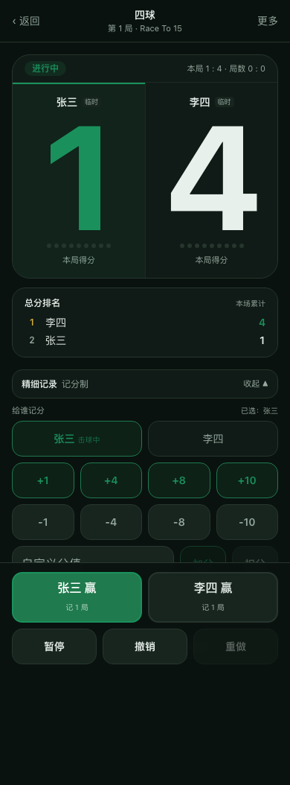
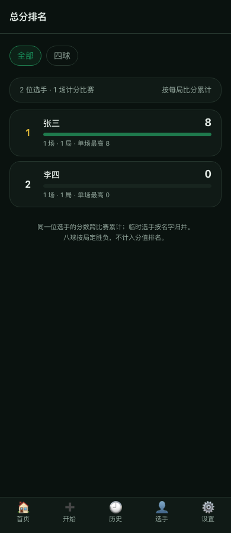

# CueScore · 台球计分

**在线使用：https://umailkit.github.io/cuescore/**（手机浏览器打开，可「添加到主屏幕」当 App 用）

一个移动端优先的台球记分 PWA。中式八球、九球、六球、四球、斯诺克五套规则引擎全部可用，
离线可跑，数据只存在本机（IndexedDB）。

不是台球游戏，是**给球桌上的人用的记分牌**：主界面只有一个问题——「本局谁赢了」，
点一下记一局并自动开下一局。四球追分例外：五个档位直接结算全桌赔付，何时收场由你决定。

<p>
  
  
  
</p>

## 功能

- **五套玩法**：中式八球、九球（记分制 / 标准清台制）、六球、四球（追分）、斯诺克
- **追分结算**：四球按规则表一键算全桌赔付（普胜/小金/大金/黄金九/黑金），零和累计
- **记分制加减分**：快捷档位 `+1 / +4 / +8 / +10`（可配），也支持自定义分值；记错能直接扣回来
- **指定给谁记分**：先选人再点档位，不选则跟随当前击球方
- **一键记局**：点「谁赢了」即记一局并自动开下一局；Race To 达标自动收场
- **撤销 / 重做**：一次操作 = 一步撤销（批量命令整组回滚），刷新不丢
- **总分排名**：每局比分跨比赛累计，按选手合并出总榜（八球按局定胜负，不计分值）
- **球员与历史**：临时球员零门槛开局，常用球员可建档；比赛历史可筛选、可回看
- **PWA**：可安装、可离线，深浅两套主题

## 技术栈

Vite 5 · React 18 · TypeScript 5.6（strict + `noUncheckedIndexedAccess`）· Tailwind 3
· Zustand · `idb`（IndexedDB）· vite-plugin-pwa
测试：Vitest（235 个单元/规则测试）+ Playwright（32 条端到端）

## 架构

四层单向依赖，`core` 不允许 import 任何上层（ESLint `no-restricted-imports` 强制）：

```
core   纯领域层：规则引擎、状态机、事件类型。零依赖，纯函数
data   持久化层：IndexedDB 仓储、EventLog、Snapshot 恢复
app    应用层：MatchService（命令编排）、boardView（UI 唯一转接面）、stores
ui     表现层：页面与组件，不持有任何规则
```

三条铁律：

1. **UI 不拥有规则** —— 页面上「哪些球可点」是 `@app/services/boardView` 从引擎算出来的，组件只负责画。
2. **UI 不依赖具体引擎** —— 新增玩法不需要改页面，只在门面里加一个分支。
3. **引擎是唯一事实来源** —— 一切状态变化走 `MatchCommand → Engine.reduce → MatchEvent`，
   `EventLog` append-only 是事实源，Snapshot 只是恢复缓存。

事件溯源带来的约束：**live `reduce` 与 EventLog 重放必须逐字段一致**。
为此关键推导字段（`continues`、`winReason`、`scores`）都随事件 payload 落盘，
并有全字段比对测试兜底。

## 本地运行

```bash
npm install
npm run dev          # http://localhost:5173
```

其他命令：

```bash
npm run build        # tsc -b && vite build
npm run preview      # 预览构建产物（E2E 跑的就是它）
npm run lint
npm test             # Vitest
npm run test:e2e     # Playwright（需先 build）
```

> Playwright 跑的是 `dist/` 产物，改完源码要 `npm run build` 才会在 E2E 里生效。

## 目录

```
src/
  core/            领域层
    engine/        五套引擎：eightBall / nineBall / sixBall / fourBall / snooker
    match/         状态机、撤销栈
    types/         Match / Command / Event / RuleSet
  data/            IndexedDB 仓储、EventLog、恢复
  app/             MatchService、boardView、ranking、stores、hooks
  ui/              pages / board / components / design
tests/
  rules/           规则引擎测试（含重放保真）
  unit/            状态机、仓储、排名聚合等
  e2e/             真实浏览器端到端
docs/
  rules/           每套玩法的规则工程化规范（口径声明 + 事件表）
  PHASE*-*.md      产品与技术架构、阶段交付报告
```

## 玩法口径

规则差异全部走 `RuleSet.config`，不写死在代码里；每套玩法的规范见 `docs/rules/`：

| 玩法 | 判胜方式 | 关键配置 |
|------|----------|----------|
| 中式八球 | 清完己方一组后合法打进 8 号 | `raceTo`、`eightBallWin` |
| 九球 | 记分制先到 `targetPoints`；或清台制合法打进 9 号 | `scoringMode`、`targetPoints`、`quickPoints` |
| 六球 | 每球 1 分，先到目标分 | `perBall`、`targetPoints` |
| 四球 | 追分制：按规则表由上家/下家赔付，整场零和累计 | `targetPoints: 0`、`scoring`、`foul` |
| 斯诺克 | 红彩交替累计得分 | `variant`、`bestOf` |

> 四球的五档追分口径（普胜 +4 / 小金 +7 / 大金 +20 / 黄金九 +8 / 黑金 −20）定义在
> `src/core/engine/fourBall/chase.ts`，引擎与 UI 共用同一份来源；
> 「上家 / 下家」按座位环形取，两人局时同一人赔付叠加。

> 九球的默认引擎行为是标准清台制，推荐模板显式覆盖为记分制——这样老比赛和老事件的
> 重放语义不会因为模板调整而改变。

## 已知限制

- 一杆多球：一次记录只处理一颗球，多球需多次点击（引擎侧已是事实事件模型）
- 八球遗留：`RERACK` 后本局无法继续、打进对方球不自动换手、`callShot` 未校验袋口
- 排行榜目前只在本机聚合，账号体系与云端同步尚未接入

## 作者

芜湖职业技术大学 · CueScore
